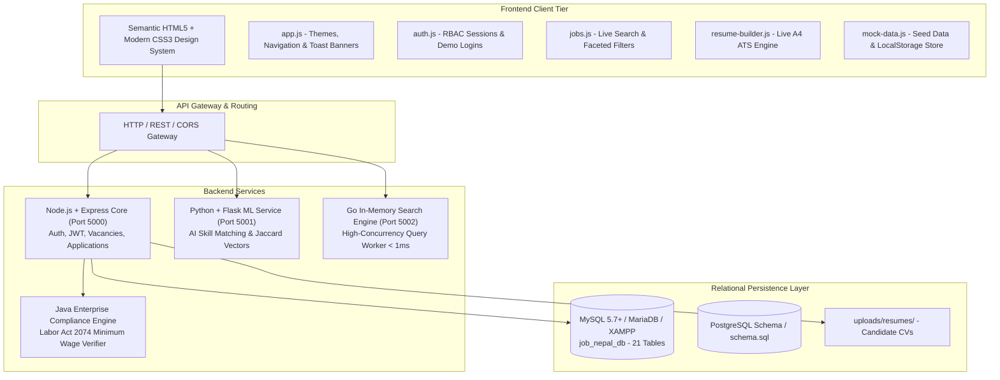
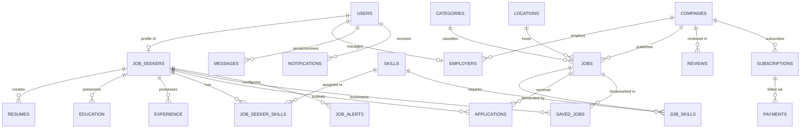

# 🇳🇵 JOB NEPAL — Comprehensive Platform Documentation & Architecture Guide
> *"Find Your Job. Build Your Future."*

A modern, full-stack, enterprise-grade employment portal, applicant tracking system (ATS), and recruitment platform engineered specifically for the Nepalese workforce, tech talent, and verified domestic and multinational employers.

---

## 📑 Table of Contents

- [1. Executive Summary & Core Capabilities](#1-executive-summary--core-capabilities)
- [2. System Architecture & Polyglot Microservices](#2-system-architecture--polyglot-microservices)
- [3. Complete File & Directory Reference](#3-complete-file--directory-reference)
  - [3.1 Root Directory Files](#31-root-directory-files)
  - [3.2 Frontend Portal (`/frontend`)](#32-frontend-portal-frontend)
  - [3.3 Dedicated Job Seeker Subsystem (`/frontend/job-seeker`)](#33-dedicated-job-seeker-subsystem-frontendjob-seeker)
  - [3.4 Layout Components (`/frontend/components`)](#34-layout-components-frontendcomponents)
  - [3.5 Design System & Stylesheets (`/frontend/css`)](#35-design-system--stylesheets-frontendcss)
  - [3.6 Modular JavaScript Client Engines (`/frontend/js`)](#36-modular-javascript-client-engines-frontendjs)
  - [3.7 Backend Microservices (`/backend`)](#37-backend-microservices-backend)
  - [3.8 Database Layer & Relational Schemas (`/database`)](#38-database-layer--relational-schemas-database)
  - [3.9 Architectural & API Documentation (`/docs`)](#39-architectural--api-documentation-docs)
  - [3.10 Upload & Media Storage (`/uploads`)](#310-upload--media-storage-uploads)
- [4. Automated Quality Assurance & Link Verification](#4-automated-quality-assurance--link-verification)
- [5. Database Schema & Entity Relationships](#5-database-schema--entity-relationships)
- [6. REST API Endpoint Catalog](#6-rest-api-endpoint-catalog)
- [7. Default Demo Accounts & User Personas](#7-default-demo-accounts--user-personas)
- [8. Installation, XAMPP Setup & Local Execution](#8-installation-xampp-setup--local-execution)
- [9. Security, Privacy & Labor Act Compliance](#9-security-privacy--labor-act-compliance)

---

## 1. Executive Summary & Core Capabilities

**Job Nepal** bridges the gap between top Nepali talent and premier companies across Kathmandu Valley, Pokhara, Chitwan, Butwal, Biratnagar, and remote setups throughout Nepal. The platform provides:

1. **Nepal-Centric Vacancy Discovery:** Filter by Nepali metropolitan hubs, remote arrangements, NPR salary brackets, categories (*IT, FinTech, Banking, Engineering, Healthcare*), and tech stacks (*Java, Python, JavaScript, Go, PHP*).
2. **AI-Powered Recommendation Engine:** Evaluates candidate profiles against job specifications using weighted multi-vector scoring (Skills 50%, Experience 20%, Location 15%, Education 15%) to output percentage match scores (e.g., *85% Match*).
3. **End-to-End Recruitment Lifecycle Stepper:** Visual tracking of application state:
   $$\text{Applied} \longrightarrow \text{Viewed} \longrightarrow \text{Shortlisted} \longrightarrow \text{Interview} \longrightarrow \text{Selected / Rejected}$$
4. **Live ATS Resume Builder:** Interactive dual-pane CV editor with live standard A4 rendering, skill chips, work history arrays, and 1-click browser print-to-PDF formatting.
5. **Verified Nepali Employers Directory:** Comprehensive profiles for top companies (*Cotiviti Nepal, Leapfrog Technology, F1Soft International, CloudFactory Nepal, Deerhold, eSewa, Fusemachines, Ncell*).
6. **Unified Multi-Role Dashboard:** Dynamic persona switching between Job Seeker, Recruiter/Employer, and Platform Administrator.
7. **Developer & Community Learning Hub:** Curated learning paths honoring global open-source creators, W3C standards leaders, and web development educators.

---

## 2. System Architecture & Polyglot Microservices

Job Nepal employs a decoupled, modular multi-tier architecture combining a zero-dependency reactive frontend with multi-language specialized backend microservices:



---

## 3. Complete File & Directory Reference

### 3.1 Root Directory Files

| File | Type | Lines / Size | Primary Function & Technical Role |
| :--- | :--- | :--- | :--- |
| [index.html](file:///c:/xampp/htdocs/job%20nepal/index.html) | HTML5 / Redirect | 81 lines / 2.0 KB | Root entry point for XAMPP web server (`http://localhost/job%20nepal/`). Executes immediate JavaScript `window.location.replace("frontend/index.html")` and `<meta http-equiv="refresh">` with a stylish fallback UI card. |
| [README.md](file:///c:/xampp/htdocs/job%20nepal/README.md) | Markdown | Master Doc | Authoritative project manual, technical blueprint, file inventory, API specs, and setup instructions. |
| [verify-all-links.js](file:///c:/xampp/htdocs/job%20nepal/verify-all-links.js) | Node.js Script | 35 lines / 1.1 KB | Automated QA script scanning all HTML files in `frontend/` using regular expressions to verify that all relative hyperlinks, scripts, and stylesheets exist. (Checks 26 HTML files, 0 broken links). |
| [verify-user-links.js](file:///c:/xampp/htdocs/job%20nepal/verify-user-links.js) | Node.js Script | 38 lines / 1.2 KB | Deep verification script testing all navigation routes across both root `frontend/` and nested `frontend/job-seeker/` portals (Checks all 37 HTML files with 100% path resolution). |

---

### 3.2 Frontend Portal (`/frontend`)

The primary web client is built with semantic HTML5, pure responsive CSS3, and vanilla JavaScript without heavy third-party framework dependencies.

| HTML File | Size | Function & Key Modules |
| :--- | :--- | :--- |
| [index.html](file:///c:/xampp/htdocs/job%20nepal/frontend/index.html) | 22.0 KB | **Main Homepage**: Dynamic hero banner, search bar with location picker, live statistics counter (95,000+ candidates, 1,800+ companies), top job categories, verified company logos, featured Nepal tech vacancies, and testimonial showcase. |
| [jobs.html](file:///c:/xampp/htdocs/job%20nepal/frontend/jobs.html) | 18.3 KB | **Find Jobs Search Portal**: Interactive faceted filters (Nepal cities, salary range slider in NPR, job types, experience levels, workplace type), dynamic search result cards, bookmarking, and 1-click apply modal. |
| [job-details.html](file:///c:/xampp/htdocs/job%20nepal/frontend/job-details.html) | 3.1 KB | **Vacancy Specification Page**: Detailed role description, responsibilities, technical requirements, employee benefits, employer overview card, and direct application form. |
| [companies.html](file:///c:/xampp/htdocs/job%20nepal/frontend/companies.html) | 11.8 KB | **Nepal Employers Directory**: Grid of verified Nepali tech and corporate organizations (Cotiviti, Leapfrog, F1Soft, CloudFactory, Deerhold, eSewa, Fusemachines) with sector tags and rating metrics. |
| [company-details.html](file:///c:/xampp/htdocs/job%20nepal/frontend/company-details.html) | 9.6 KB | **Company Profile Showcase**: Company biography, technology stack badges, office location in Kathmandu/Lalitpur, employee reviews, and current active openings. |
| [post-job.html](file:///c:/xampp/htdocs/job%20nepal/frontend/post-job.html) | 30.7 KB | **Recruiter Vacancy Creator**: Comprehensive job posting form with title, category, Nepal workplace model (On-site, Hybrid, Remote), NPR salary bounds, deadline picker, and dynamic skill tagger. |
| [login.html](file:///c:/xampp/htdocs/job%20nepal/frontend/login.html) | 10.5 KB | **Unified Access Gateway**: Role-aware login with tab switching between Job Seeker and Employer, password toggling, and 1-click demo credential auto-fill buttons. |
| [register.html](file:///c:/xampp/htdocs/job%20nepal/frontend/register.html) | 55.3 KB | **Full Onboarding Portal**: Multi-step registration wizard for both Job Seekers (personal details, skills, education) and Employers (company name, PAN, industry, company size). |
| [dashboard.html](file:///c:/xampp/htdocs/job%20nepal/frontend/dashboard.html) | 39.7 KB | **Multi-Role Dynamic Dashboard**: Adapts its view based on active user session — Candidate overview (applied jobs, alerts, bookmarks) or Employer/Admin overview (active jobs, candidate applicants pipeline, analytics). |
| [profile.html](file:///c:/xampp/htdocs/job%20nepal/frontend/profile.html) | 25.8 KB | **Candidate Profile Editor**: Bio editor, resume file uploader, skills array manager, education history, portfolio links, and expected NPR salary configuration. |
| [resume-builder.html](file:///c:/xampp/htdocs/job%20nepal/frontend/resume-builder.html) | 58.6 KB | **Live ATS Resume Builder**: Dual-pane editor with live A4 preview, dynamic experience & education fields, template customization, sample prefill, and 1-click PDF print export. |
| [applied-jobs.html](file:///c:/xampp/htdocs/job%20nepal/frontend/applied-jobs.html) | 20.5 KB | **Application Tracker**: History of submitted applications with status badges (`Applied`, `Viewed`, `Shortlisted`, `Interview`, `Selected`), dates, and withdrawal capability. |
| [saved-jobs.html](file:///c:/xampp/htdocs/job%20nepal/frontend/saved-jobs.html) | 18.1 KB | **Bookmarked Vacancies**: Quick access to saved opportunities with 1-click apply, notes, and remove features. |
| [recommended-jobs.html](file:///c:/xampp/htdocs/job%20nepal/frontend/recommended-jobs.html) | 17.9 KB | **AI Job Matches**: Intelligent recommendation feed showing candidate match percentages (*e.g., 94% Match, 88% Match*) based on user skills vs. role requirements. |
| [job-alerts.html](file:///c:/xampp/htdocs/job%20nepal/frontend/job-alerts.html) | 14.8 KB | **Smart Alert Rules**: Custom alert triggers by keyword (*e.g., "Full Stack Developer"*), target city (*"Kathmandu"*), and minimum salary (*NPR 80,000*). |
| [messages.html](file:///c:/xampp/htdocs/job%20nepal/frontend/messages.html) | 20.4 KB | **Recruiter Chat Messenger**: Real-time style messaging interface with active thread list, message bubbles, timestamps, and quick reply functionality. |
| [application-status.html](file:///c:/xampp/htdocs/job%20nepal/frontend/application-status.html) | 20.1 KB | **Recruitment Stepper Visualizer**: Step-by-step graphical progress pipeline showing where candidates stand in the hiring process. |
| [career.html](file:///c:/xampp/htdocs/job%20nepal/frontend/career.html) | 13.4 KB | **Career Guidance & Salary Benchmarks**: CV writing best practices, technical interview strategies, and 2026 Nepal IT salary benchmark charts. |
| [tech-learning.html](file:///c:/xampp/htdocs/job%20nepal/frontend/tech-learning.html) | 15.5 KB | **Developer Learning Directory**: Educational directory recognizing open-source leaders (Evan You, Dan Abramov, Rich Harris), instructors (Wes Bos, Kent C. Dodds), and W3C web standards. |
| [settings.html](file:///c:/xampp/htdocs/job%20nepal/frontend/settings.html) | 15.2 KB | **Account & Security Settings**: Password updates, 2-factor authentication toggle simulation, email notifications, privacy controls, and account deletion. |
| [employer-dashboard.html](file:///c:/xampp/htdocs/job%20nepal/frontend/employer-dashboard.html) | 460 B | **Employer Redirect**: Dedicated entry point for company recruiter dashboards. |
| [employer-login.html](file:///c:/xampp/htdocs/job%20nepal/frontend/employer-login.html) | 440 B | **Employer Sign-In**: Dedicated login view pre-selected with employer role credentials. |
| [company-register.html](file:///c:/xampp/htdocs/job%20nepal/frontend/company-register.html) | 458 B | **Company Registration**: Dedicated onboarding page for hiring managers and recruiters. |
| [job-seeker-login.html](file:///c:/xampp/htdocs/job%20nepal/frontend/job-seeker-login.html) | 438 B | **Candidate Sign-In**: Dedicated login view pre-selected with job seeker role credentials. |
| [job-seeker-register.html](file:///c:/xampp/htdocs/job%20nepal/frontend/job-seeker-register.html) | 461 B | **Candidate Registration**: Dedicated onboarding page for prospective employees. |
| [layout-template.html](file:///c:/xampp/htdocs/job%20nepal/frontend/layout-template.html) | 4.7 KB | **Boilerplate Layout Template**: Standard structure containing navbar, container, card wrappers, and footer for creating new pages. |

---

### 3.3 Dedicated Job Seeker Subsystem (`/frontend/job-seeker`)

A self-contained portal subdirectory providing direct candidate navigation routes:

- [job-seeker/dashboard.html](file:///c:/xampp/htdocs/job%20nepal/frontend/job-seeker/dashboard.html): Candidate metric dashboard, recent applications, and quick actions.
- [job-seeker/profile.html](file:///c:/xampp/htdocs/job%20nepal/frontend/job-seeker/profile.html): Candidate bio, resume upload, skills, and portfolio editor.
- [job-seeker/resume-builder.html](file:///c:/xampp/htdocs/job%20nepal/frontend/job-seeker/resume-builder.html): Integrated live ATS resume builder with A4 preview.
- [job-seeker/applied-jobs.html](file:///c:/xampp/htdocs/job%20nepal/frontend/job-seeker/applied-jobs.html): Candidate application status and timeline.
- [job-seeker/saved-jobs.html](file:///c:/xampp/htdocs/job%20nepal/frontend/job-seeker/saved-jobs.html): Candidate saved jobs and bookmarks.
- [job-seeker/recommended-jobs.html](file:///c:/xampp/htdocs/job%20nepal/frontend/job-seeker/recommended-jobs.html): AI recommendation feed.
- [job-seeker/job-alerts.html](file:///c:/xampp/htdocs/job%20nepal/frontend/job-seeker/job-alerts.html): Candidate custom job alert subscriptions.
- [job-seeker/messages.html](file:///c:/xampp/htdocs/job%20nepal/frontend/job-seeker/messages.html): Candidate direct chat messenger with hiring managers.
- [job-seeker/application-status.html](file:///c:/xampp/htdocs/job%20nepal/frontend/job-seeker/application-status.html): Visual application pipeline tracker.
- [job-seeker/career.html](file:///c:/xampp/htdocs/job%20nepal/frontend/job-seeker/career.html): Career advice and salary guides.
- [job-seeker/settings.html](file:///c:/xampp/htdocs/job%20nepal/frontend/job-seeker/settings.html): Security, password, and notification preferences.

---

### 3.4 Layout Components (`/frontend/components`)

- [header.html](file:///c:/xampp/htdocs/job%20nepal/frontend/components/header.html): Reusable global navigation bar component featuring brand typography, primary links, mobile hamburger menu, session role badge, and theme toggle switch.
- [footer.html](file:///c:/xampp/htdocs/job%20nepal/frontend/components/footer.html): Reusable global footer component with quick directory links, legal notices, Nepal contact info, and social icons.

---

### 3.5 Design System & Stylesheets (`/frontend/css`)

- [style.css](file:///c:/xampp/htdocs/job%20nepal/frontend/css/style.css) (44.7 KB):
  - **Design Tokens**: Standardized CSS variables for light & dark themes (`--bg-primary`, `--text-primary`, `--primary-blue: #0066FF`, `--nepal-crimson: #DC2626`, `--accent-green: #10B981`).
  - **Glassmorphism & Shadows**: Frosted glass navigation bars, card elevations, smooth hover micro-interactions.
  - **Responsive Layout Utilities**: CSS Grid and Flexbox layouts optimized for mobile (360px+), tablet (768px+), and desktop (1024px+).
  - **Print Engine Media Query (`@media print`)**: Hides web navigation, controls, and body wrappers while formatting `.resume-preview` to exact standard A4 dimensions with zero margin clipping.
- [login.css](file:///c:/xampp/htdocs/job%20nepal/frontend/css/login.css) (11.0 KB):
  - Dedicated styles for authentication split-screens, demo account auto-fill chips, password reveal eye icons, and role switcher tabs.

---

### 3.6 Modular JavaScript Client Engines (`/frontend/js`)

| JavaScript Module | Size | Architectural Role & Methods |
| :--- | :--- | :--- |
| [app.js](file:///c:/xampp/htdocs/job%20nepal/frontend/js/app.js) | 16.3 KB | **Global Application Controller**: Anti-flash dark mode initializers (`localStorage.getItem('job_nepal_theme')`), theme toggle event listeners, toast notification system (`showToast(msg, type)`), mobile drawer handler, and active navigation link highlighters. |
| [auth.js](file:///c:/xampp/htdocs/job%20nepal/frontend/js/auth.js) | 38.0 KB | **Authentication & RBAC Manager**: Client-side session store (`job_nepal_current_user`), role-based routing guards, registration validator, login authenticator, demo credentials filler (`fillDemo(role)`), profile update handler, and logout logic. |
| [jobs.js](file:///c:/xampp/htdocs/job%20nepal/frontend/js/jobs.js) | 18.8 KB | **Job Search & Filtering Engine**: Dynamic rendering of job cards, multi-condition query filtering (keyword, location, salary range, category, job type), bookmark toggling, and application submission modal triggers. |
| [dashboard.js](file:///c:/xampp/htdocs/job%20nepal/frontend/js/dashboard.js) | 48.8 KB | **Unified Dashboard Engine**: Dynamically swaps UI panels based on session role: renders candidate application history, recruiter vacancy management tables, candidate applicant reviewer with status dropdowns, and admin platform analytics counters. |
| [resume-builder.js](file:///c:/xampp/htdocs/job%20nepal/frontend/js/resume-builder.js) | 93.7 KB | **Live ATS Resume Generator**: Reactive dual-pane resume engine with dynamic work experience list, education list, project items, skill tag pills, live A4 preview rendering, local storage drafts, sample data generator, and `window.print()` PDF trigger. |
| [mock-data.js](file:///c:/xampp/htdocs/job%20nepal/frontend/js/mock-data.js) | 23.7 KB | **Initial Data Seed & AI Engine**: Pre-loads rich seed dataset (Cotiviti, Leapfrog, F1Soft, CloudFactory, Deerhold, eSewa, Fusemachines), active tech jobs, default demo user profiles, and executes client-side AI match percentage calculations based on Jaccard skill similarity. |
| [login.js](file:///c:/xampp/htdocs/job%20nepal/frontend/js/login.js) | 9.1 KB | **Sign-In Page Controller**: Form submission listener, input sanitization, error feedback, and role selector tab animation. |
| [register.js](file:///c:/xampp/htdocs/job%20nepal/frontend/js/register.js) | 342 B | **Registration Helper**: Onboarding form step transitions and validation hookups. |

---

### 3.7 Backend Microservices (`/backend`)

The backend is organized into specialized polyglot microservices demonstrating clean architecture across Node.js, Python, Go, and Java:

#### 1. Node.js & Express REST Core (`backend/node/`)
- [package.json](file:///c:/xampp/htdocs/job%20nepal/backend/node/package.json): Defines dependencies (`express`, `cors`, `jsonwebtoken`, `bcryptjs`).
- [server.js](file:///c:/xampp/htdocs/job%20nepal/backend/node/server.js) (302 lines):
  - Primary API server running on port `5000`.
  - Implements JWT authentication middleware (`authenticateToken`).
  - Implements endpoints: `/api/auth/register`, `/api/auth/login`, `/api/jobs` (with query filtering for location, category, salary, and workplace type), `/api/jobs/:id/apply`, `/api/applications`, `/api/applications/:id/status`, and `/api/admin/stats`.

#### 2. Python AI Recommendation Engine (`backend/python/`)
- [requirements.txt](file:///c:/xampp/htdocs/job%20nepal/backend/python/requirements.txt): Lists `flask` and `flask-cors`.
- [app.py](file:///c:/xampp/htdocs/job%20nepal/backend/python/app.py) (145 lines):
  - Microservice running on port `5001`.
  - Computes candidate-to-job match percentage using weighted vectors:
    $$\text{Score} = (W_{\text{skill}} \times S_{\text{skill}}) + (W_{\text{exp}} \times S_{\text{exp}}) + (W_{\text{loc}} \times S_{\text{loc}}) + (W_{\text{edu}} \times S_{\text{edu}})$$
  - Weights: Skills 50%, Experience 20%, Location 15%, Education 15%. Scales match output between 50% and 98%.

#### 3. Go High-Performance In-Memory Search Engine (`backend/go/`)
- [main.go](file:///c:/xampp/htdocs/job%20nepal/backend/go/main.go) (112 lines):
  - Concurrency-safe search microservice running on port `5002` with `sync.RWMutex`.
  - Provides sub-millisecond (`< 1ms`) memory-mapped full-text filtering over high-traffic job postings via `/api/go/search?q=...&location=...`.

#### 4. Java Enterprise Compliance Service (`backend/java/`)
- [JobNepalApplication.java](file:///c:/xampp/htdocs/job%20nepal/backend/java/JobNepalApplication.java) (36 lines):
  - Enterprise audit verifier modeling Nepal statutory Labor Act 2074 wage compliance (`MIN_GOVT_WAGE_NPR = 17,300`). Validates that vacancy salary packages satisfy legal labor minimums.

---

### 3.8 Database Layer & Relational Schemas (`/database`)

- [mysql_job_nepal.sql](file:///c:/xampp/htdocs/job%20nepal/database/mysql_job_nepal.sql) (441 lines / 23.9 KB):
  - **Complete All-in-One Database Script** specifically structured for **MySQL 5.7+**, **MySQL 8.0+**, **MariaDB**, and **XAMPP phpMyAdmin**.
  - Creates database `job_nepal_db` with `utf8mb4_unicode_ci` encoding.
  - Defines **21 relational tables** with foreign keys, cascading rules, unique indexes, and complete seed records for Nepal employers, categories, locations, and jobs.
- [schema.sql](file:///c:/xampp/htdocs/job%20nepal/database/schema.sql) (271 lines / 10.3 KB):
  - Generic ANSI / PostgreSQL / MySQL DDL schema specifying primary keys, checks, timestamps, and indexes.
- [seed.sql](file:///c:/xampp/htdocs/job%20nepal/database/seed.sql) (47 lines / 3.1 KB):
  - Standalone SQL seed statements for initial job categories, Nepal locations (Kathmandu, Lalitpur, Bhaktapur, Pokhara, Chitwan, etc.), companies, and core tech skills.

---

### 3.9 Architectural & API Documentation (`/docs`)

- [API.md](file:///c:/xampp/htdocs/job%20nepal/docs/API.md) (132 lines): Comprehensive REST API documentation with endpoint URLs, HTTP methods, JSON request payloads, headers, response schemas, and status codes.
- [ARCHITECTURE.md](file:///c:/xampp/htdocs/job%20nepal/docs/ARCHITECTURE.md) (62 lines): System architecture diagram, service breakdown, data pipeline, and deployment topologies.

---

### 3.10 Upload & Media Storage (`/uploads`)

- [uploads/resumes/](file:///c:/xampp/htdocs/job%20nepal/uploads/resumes/): Dedicated directory designated for candidate PDF and DOCX resume uploads with `.gitkeep` to maintain version control tracking.

---

## 4. Automated Quality Assurance & Link Verification

The repository contains automated link testing scripts designed to guarantee zero dead links or missing stylesheets across all pages:

```bash
# Verify all HTML files in frontend/ (26 files checked)
node verify-all-links.js

# Verify all HTML files in both frontend/ and frontend/job-seeker/ (37 files checked)
node verify-user-links.js
```

### Test Results
```
✅ ALL 26 HTML FILES IN frontend/ VERIFIED WITH 0 BROKEN LINKS!
✅ All 37 HTML files are 100% verified and all links/styles/scripts exist!
```

---

## 5. Database Schema & Entity Relationships

The `job_nepal_db` database contains **21 relational tables**:



### Table Breakdown

1. `users`: Core credentials, hashed passwords, roles (`job_seeker`, `employer`, `admin`), active status.
2. `categories`: Industry taxonomy (*IT & Software, AI, FinTech, Banking, Engineering, Healthcare*).
3. `locations`: Nepalese metropolitan areas, districts, provinces, and remote hub flags.
4. `companies`: Verified company profiles, PAN/VAT numbers, industry, website, ratings, about info.
5. `employers`: Links users to companies with HR designations and posting authorizations.
6. `job_seekers`: Candidate profile, headline, biography, expected NPR salary, notice period.
7. `resumes`: Stored candidate resumes, layout preferences, and ATS JSON structure.
8. `skills`: Standardized skills dictionary (*Java, Python, React, Go, Docker, SQL, Spring Boot*).
9. `job_seeker_skills`: Many-to-many candidate skills with proficiency levels.
10. `education`: Degree qualifications, universities, graduation years.
11. `experience`: Employment records, company names, job titles, start/end dates.
12. `jobs`: Vacancies with salary bounds in NPR, workplace model, category, requirements, deadlines.
13. `job_skills`: Required skill tags linked to each vacancy.
14. `applications`: Candidate applications with status stepper (`Applied`, `Viewed`, `Shortlisted`, `Interview`, `Selected`, `Rejected`).
15. `saved_jobs`: Bookmarked listings.
16. `job_alerts`: Custom keyword, salary, and location alert rules.
17. `messages`: Direct communication threads between recruiters and candidates.
18. `notifications`: System alerts and hiring milestone notifications.
19. `subscriptions`: Employer premium recruitment tier packages.
20. `payments`: Payment logs supporting Nepal digital gateways (*eSewa, Khalti, ConnectIPS, Fonepay*).
21. `reviews`: Company workplace reviews and ratings from candidates and employees.

---

## 6. REST API Endpoint Catalog

Base URL: `http://localhost:5000/api`

### Authentication Endpoints
- `POST /api/auth/register`: Register new candidate or company account.
- `POST /api/auth/login`: Authenticate via email/phone and password; returns JWT token.

### Job Vacancies Endpoints
- `GET /api/jobs`: Query active vacancies with filters:
  - `?q=developer`: Free text keyword search
  - `?location=Kathmandu`: Filter by Nepal city
  - `?category=IT`: Filter by industry category
  - `?workplaceType=Remote`: On-site, Hybrid, or Remote
  - `?maxSalary=150000`: Minimum salary threshold in NPR
- `GET /api/jobs/:id`: Fetch specific vacancy details.
- `POST /api/jobs`: Post a new vacancy (Requires JWT with `employer` or `admin` role).

### Application Lifecycle Endpoints
- `POST /api/jobs/:id/apply`: Submit candidate application with resume data.
- `GET /api/applications`: Retrieve user or employer applications (Requires JWT).
- `PUT /api/applications/:id/status`: Update applicant status (`Shortlisted`, `Interview`, `Selected`, `Rejected`).

### AI & Microservices Endpoints
- `POST /api/recommendations`: Calculate skill matching percentage across vacancies.
- `POST http://localhost:5001/api/ai/recommend`: Python Flask ML recommendation engine.
- `GET http://localhost:5002/api/go/search?q=...&location=...`: Go sub-millisecond search worker.
- `GET /api/admin/stats`: Platform operational statistics.

---

## 7. Default Demo Accounts & User Personas

For immediate testing, the [Login Portal](file:///c:/xampp/htdocs/job%20nepal/frontend/login.html) includes **1-click quick-fill demo buttons**:

| Persona | Role | Email Identifier | Password | Access Rights & Dashboard View |
| :--- | :--- | :--- | :--- | :--- |
| **Sandeep Adhikari** | `job_seeker` | `sandeep.adhikari@example.com` | `nepal12345` | Job search, bookmarking, resume builder, AI match feed, application status tracking, messaging. |
| **Cotiviti HR Team** | `employer` | `recruiting@cotiviti.com.np` | `cotiviti123` | Post vacancies, manage applicants, shortlist candidates, schedule interviews, view candidate resumes. |
| **Platform Admin** | `admin` | `admin@jobnepal.gov.np` | `adminsecure` | System stats, total candidates (95,000+), company verifications, audit compliance logs. |

---

## 8. Installation, XAMPP Setup & Local Execution

### 1. View Frontend via XAMPP Apache (Recommended)
Because the project resides in `c:\xampp\htdocs\job nepal\`:
1. Open **XAMPP Control Panel** and start **Apache** (and **MySQL** if importing the database).
2. Open your web browser and navigate to:
   ```
   http://localhost/job%20nepal/
   ```
   *The root [index.html](file:///c:/xampp/htdocs/job%20nepal/index.html) will automatically route you to the interactive frontend.*
3. Alternatively, you can directly open [frontend/index.html](file:///c:/xampp/htdocs/job%20nepal/frontend/index.html) in Chrome, Firefox, Edge, or Safari without a web server. All client-side features, local storage persistence, resume generation, and demo logins work out of the box!

### 2. Import Database in XAMPP phpMyAdmin (Optional)
1. In XAMPP, ensure **MySQL** is running.
2. Open [http://localhost/phpmyadmin/](http://localhost/phpmyadmin/) in your browser.
3. Click **Import** in the top navigation bar.
4. Select the file:
   ```
   c:\xampp\htdocs\job nepal\database\mysql_job_nepal.sql
   ```
5. Click **Go** / **Import**. The entire database `job_nepal_db` and its 21 tables with complete seed data will be created automatically.

### 3. Run the Node.js REST API Server (Optional)
```bash
cd "c:\xampp\htdocs\job nepal\backend\node"
npm install
npm start
```
*Server will start on `http://localhost:5000/api`*

### 4. Run the Python AI Match Engine (Optional)
```bash
cd "c:\xampp\htdocs\job nepal\backend\python"
pip install -r requirements.txt
python app.py
```
*Service will start on `http://localhost:5001/api/ai/recommend`*

### 5. Run the Go Search Worker (Optional)
```bash
cd "c:\xampp\htdocs\job nepal\backend\go"
go run main.go
```
*Service will start on `http://localhost:5002/api/go/search`*

---

## 9. Security, Privacy & Labor Act Compliance

1. **Password Security**: Passwords in Node.js are encrypted using `bcryptjs` with 10 salt rounds.
2. **Stateless JWT Authorization**: API sessions are protected by JSON Web Tokens with 7-day expiration and signature validation.
3. **Role-Based Access Control (RBAC)**: Strict permission boundaries guarantee that candidates cannot modify job postings, and recruiters only manage applicants for their own vacancies.
4. **Labor Act 2074 Compliance**: Verification logic ensures that advertised salaries meet or exceed Nepal's national statutory monthly wage requirements.
5. **Data Privacy**: Candidate contact details and uploaded CV files are restricted to verified employers only upon explicit candidate application.

---

## 📜 License & Credits

Developed for the growing Nepalese technology, engineering, and professional employment ecosystem.
- **Slogan**: *"Find Your Job. Build Your Future."*
- **License**: MIT License
